  

  <b>Adopt a tiny pixel pet that lives at the bottom of every Chrome tab.</b> 
  Feed it, pet it, play ball, watch it nap in a nightcap — and grow your bond a little every day.

  
  
  
  
  
  

  <a href="https://YOUR-WEBSITE.com"><b>🌐 Website</b></a> ·
  <a href="#-install">Install</a> ·
  <a href="#-features">Features</a> ·
  <a href="#-wardrobe">Wardrobe</a> ·
  <a href="#-bond-levels--daily-care">Bond levels</a> ·
  <a href="#-pet-pixi-pro--photo-pet--wardrobe">Pro</a> ·
  <a href="#-privacy">Privacy</a> ·
  <a href="#-faq">FAQ</a>

---

## 🐾 Meet the pets

27 hand-made pixel friends. Pick one (or up to **five** — ten with Pro) and they follow you from tab to tab.

  

Every pet has its own favourite food 🍖 — feed them that and they're extra happy.

| Pet | Loves | Pet | Loves | Pet | Loves |
|---|---|---|---|---|---|
| Bunny | carrot | Fox | bone | Rat | cheese |
| Cat | fish | Frog | bug | Rocky | cookie |
| Chicken | seeds | Horse | carrot | Rubber Duck | bread |
| Clippo | cookie | Mod | bolt | Skeleton | bone |
| Cockatiel | seeds | Monkey | banana | Snail | leaf |
| Crab | fish | Morph | apple | Snake | apple |
| Dog | bone | Panda | bamboo | Squirrel | acorn |
| Dino | leaf | Raccoon | cookie | Mossling | acorn |
| Finley | bug | Turtle | leaf | Zappy | bolt |

---

## ✨ Features

### 🏡 Lives in your tabs
- Your pets walk, idle, blink, nap and explore along the **bottom of every website** you open.
- **Synced across all your tabs** — same pets, same stats, and your pet is right where you left it when you switch tabs.
- **Hover** a pet for its little toolbar: 🍖 Feed · ⚽ Play · ❤️ Pet · 🌙 Nap · ✕ Hide.
- **Click** to pet it, or **stroke** it by moving your mouse back and forth over it.
- **Drag & drop** your pet anywhere — it tumbles back down with a bounce.

### 🤝 Friends & meetups
When two pets bump into each other, they play out a little scene:

  

| Scene | What happens |
|---|---|
| 💬 **Chat** | They take turns "talking" in speech bubbles — ♪ ? … ✦ ❤️ — hopping as they speak, then wave goodbye. |
| 🦘 **Leapfrog** | One crouches, the other jumps right over it to the far side ✦ |
| 🏃 **Tag** | "!" — one runs off, the other chases, then a happy hop. |
| 💃 **Dance** | Alternating hops, little spins and music notes. |
| 😴 **Snuggle** *(night)* | They curl up side by side for a nap. |

Pets also wander over to visit each other on their own, and meetups make both of them happier.

### 🌙 Day & night

  

After **8 pm** pets slow down, glow softly, fall asleep in little **nightcaps** and fireflies come out. In the morning they wake up with a stretch and a ☀️. (Settings: *Follow clock · Always · Never*.)

### 🧭 Free roam *(optional)*
Turn it on and pets explore **every edge of the window** — up the walls and upside down along the top. Food and balls still land on the floor, so pets walk all the way round to reach them.

### 👗 Wardrobe

  

Dress your pets in the **Wardrobe** tab: pick a pet, then tap through **Hats · Face · Neck · Outfits · Back · Coats**. Every tile shows *your* pet wearing the item, and the big preview turns around and tries on any look. Feeling lucky? Hit **🎲 Surprise me**.

- **Free bond rewards** — one new item at every bond level: 🎀 bow · 🔔 collar & bell · 🌸 flower · 🧣 bandana · 🥳 party hat · 😊 blush · 👑 crown · 🧶 scarf · ⭐ star.
- **With Pro** — 81 colour coats, outfits (hoodie, striped sweater, raincoat, denim jacket, tuxedo, bumblebee, ghost), wings (angel, bat, butterfly, fairy), a hero cape and a balloon, bow ties, pearls, flower leis and gold chains, 17 hats from wizard to pirate, and shades, monocles and eye patches.
- Everything fits all 27 pets, and your pets wear their look on every website.

### 🎨 Make it yours
- **Pet size** from tiny to big.
- **Pixel style:** *HD pixels* (smooth, shaded, sparkly eyes) or *Retro* (chunky classic pixels).
- **Popup theme:** follows your computer's light or dark mode, or pick one.
- **Name** every pet and see how many days you've been together.

### 🙈 Hide anytime
Three easy ways, each with **this tab / this site / all tabs**:
1. **Right-click** any page (or the toolbar icon) → *Hide pets on this tab / site / all tabs*.
2. The pet's **✕** button.
3. The **popup** — one click to hide or show again.

Pets also hide automatically in **fullscreen** video.

---

## ❤️ Bond levels & daily care

Bond shows how close you and a pet are. It grows from **caring a little every day** — not from clicking fast — and it **never goes down**. Pets never die, run away or get sick. 🫶

| Activity | XP | Daily limit |
|---|---|---|
| 🍖 Feed when hungry | +3 (+5 with favourite food) | 3 meals, 45 min apart — full pets politely refuse |
| ⚽ Play ball | +4 | 3 games — pets catch their breath for 3 min between games |
| ❤️ Pet / stroke | +1 | 10 cuddles |
| ✅ **Daily care goal** — 1 meal + 1 game + 5 cuddles | **+5 bonus** | once a day |
| 📅 Daily visit | +5, plus +2 per day in a row (up to +10) | once a day |

Each pet can earn up to **30 XP a day** from feeding, playing and cuddles. The popup shows today's progress on every pet.

| Lv | Title | XP | Unlocks |
|---|---|---|---|
| 1 | New friend | 0 | — |
| 2 | Buddy | 15 | 🎀 Bow |
| 3 | Pal | 45 | 🔔 Collar & bell |
| 4 | Close friend | 90 | 🌸 Flower |
| 5 | Best friend | 150 | 🧣 Bandana |
| 6 | Partner | 230 | 🥳 Party hat |
| 7 | Soulmate | 330 | 😊 Blush |
| 8 | Family | 450 | 👑 Crown |
| 9 | Inseparable | 600 | 🧶 Scarf |
| 10 | **Legendary bond** | 800 | ⭐ Star |

Bond rewards are always free. Unlocked items appear in the **Wardrobe** tab — locked ones can still be tried on in the preview.

---

## ⭐ Pet Pixi Pro — Photo Pet & Wardrobe

> **One-time purchase · no subscription · no account** — everything else in Pet Pixi is free.

Turn a photo of **your real pet** into a Pet Pixi that lives in your tabs, and open the full wardrobe for every pet.

- 📷 Upload a photo → choose the look you like:
  - **Original photo** — your real picture, neatly cut out with a soft white sticker edge.
  - **Pixel art** — converted to pixel art that matches the other pets.
- ✨ **Best result:** a **PNG with a transparent background** (cut your pet out first with your phone's "lift subject" / "remove background" tool). Ordinary photos work too — plain backgrounds are removed automatically.
- 🔒 **Your photo never leaves your computer.** Everything is processed inside the extension; only the small finished pet is kept.
- 🐕 **Walks like your pet:** tell it what kind of pet it is — dog, cat, bunny, bird, flying, duck, hamster, turtle or snake/fish — and it trots, hops, struts, flies or slithers to match. You can change it later.
- 👗 **A whole wardrobe:** 81 colour coats (black cat, golden retriever, albino rat, blue dino…), hoodies, sweaters, raincoats, tuxedos and bee or ghost costumes, angel, bat, butterfly and fairy wings, a hero cape, bow ties and pearls, 17 hats from wizard to pirate, and shades, monocles and eye patches. Try anything on in the Wardrobe tab.
- 🎀 **Dress it your way:** drag bows, hats, flowers and the nightcap to the perfect spot on your photo, and make them bigger or smaller.
- 🐾 **A bigger family:** keep up to **10 pets** instead of 5.

**How buying works** — payments by [Lemon Squeezy](https://www.lemonsqueezy.com), who handle checkout, receipts, taxes and refunds:
1. Open the Pet Pixi popup → **Pro ★** → **Unlock Pro** (the current price is shown there). Or tap any ★ Pro item in the Wardrobe.
2. Pay on the secure Lemon Squeezy checkout. Your **license key** arrives by email.
3. Paste the key into the popup (**Pro ★** → *Already bought Pro? Enter your key*) → **Activate**. Done — no sign-up, no password.

If you're offline, Pro keeps working.

---

## 🔒 Privacy

Pet Pixi is private by design.

- **No accounts, no ads, no tracking of what you browse.** Pet Pixi never reads page content, web addresses or anything you type.
- Your pets and settings live **only on your computer** — uninstalling removes them.
- Photo Pet photos are processed **on your computer** and never uploaded.
- **Optional anonymous usage stats** (switch off any time in *Settings*): once a day a random install id, version, browser language, pet types and whether Pro is on. Your **IP address is never stored**.

Full privacy policy: **[PRIVACY.md](PRIVACY.md)**

<b>Permissions and why they're needed</b>

| Permission | Why |
|---|---|
| Read and change data on websites | Draw your pets on the pages you visit. Pet Pixi doesn't read page content. |
| Storage | Save your pets and settings on your computer. |
| Alarms | Show the "someone is hungry" badge and send the optional daily stats ping. |
| Scripting | Add pets to tabs that were already open when you installed. |
| Context menus | The right-click *Hide pets…* options. |
| `api.lemonsqueezy.com` | Activate your Pro license key. |

---

## 📦 Install

  <b>Chrome Web Store:</b> <i>coming soon</i> — follow <a href="https://YOUR-WEBSITE.com">YOUR-WEBSITE.com</a> for the launch.

1. Click **Add to Chrome** on the Chrome Web Store page.
2. The welcome page opens — pick your first pet and give it a name.
3. Open any website and look down. Your new friend is already exploring. 🎉

Tip: pin Pet Pixi from the 🧩 puzzle-piece menu so your pets are one click away.
Works in Chrome and other Chromium browsers (Edge, Brave, Opera).

---

## 🗺 Roadmap

- [x] A wardrobe with outfits, wings, hats and coats
- [ ] Seasonal events (snowy days, spooky nights)
- [ ] A little pet diary
- [ ] Export / import your pets
- [ ] Optional cute sounds (off by default)
- [ ] Call your pet to the cursor with a shortcut
- [ ] More poses for Photo Pets

Ideas welcome — open an issue! 💡

---

## ❓ FAQ

<b>Why don't pets appear on the New Tab page?</b>

Chrome doesn't allow any extension to draw on the New Tab page, `chrome://` pages or the Chrome Web Store. Open any regular website and your pets are there.

<b>Can my pet die or run away if I forget it?</b>

Never. Hungry or lonely pets just look a bit sad and show a small bubble. Bond levels never go down.

<b>Will my pets sync to my other computer?</b>

No — on purpose. Pets live only in this Chrome profile, with no account. Another Chrome (or profile) starts fresh, so you can adopt different friends there.

<b>Why didn't I get XP when I clicked Feed again?</b>

Bond grows from daily care, not fast clicking: full pets refuse food, meals give XP up to 3 times a day, and pets rest between games. The popup tells you exactly why and when.

<b>Is Pro a subscription? Can I get a refund?</b>

Pro is a **one-time** purchase — no subscription. Payments, receipts and refunds are handled by Lemon Squeezy — reply to your receipt email or visit <a href="https://github.com/ThevinMalaka/pet-pixi-chrome-extension">github.com/ThevinMalaka/pet-pixi-chrome-extension</a>.

<b>Is my photo uploaded anywhere?</b>

No. Photo Pet processing happens entirely inside the extension on your computer.

<b>How do I hide pets on a website I'm working on?</b>

Right-click the page → *Hide pets on this site*, or use the pet's ✕ button. Bring them back the same way or from the popup.

---

## 💌 Support

Questions, bugs or pet ideas: **[github.com/ThevinMalaka/pet-pixi-chrome-extension](https://github.com/ThevinMalaka/pet-pixi-chrome-extension)** or open an issue here.

## 📄 License

© 2026 Pet Pixi. All rights reserved. The Pet Pixi name, pixel art and software may not be copied, modified, redistributed or sold without written permission.

  <a href="https://YOUR-WEBSITE.com">🌐 YOUR-WEBSITE.com</a> · Made with 💖 and lots of tiny pixels.

