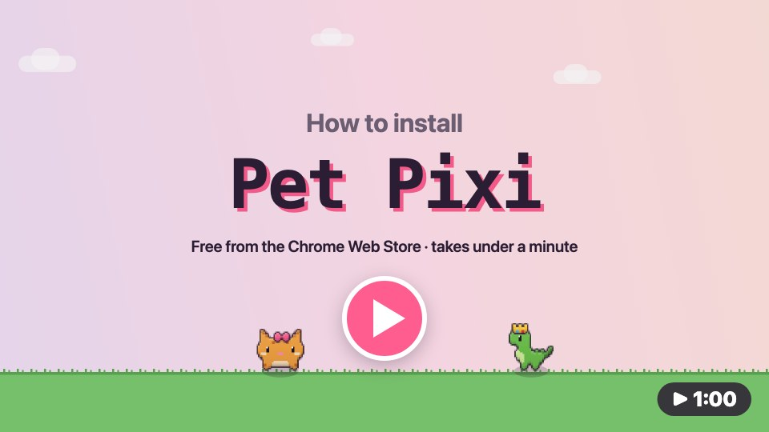
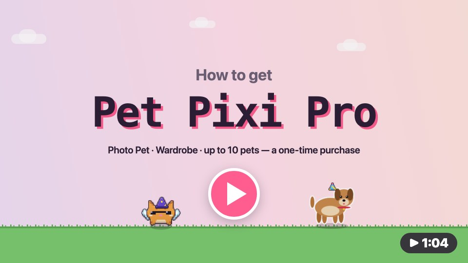
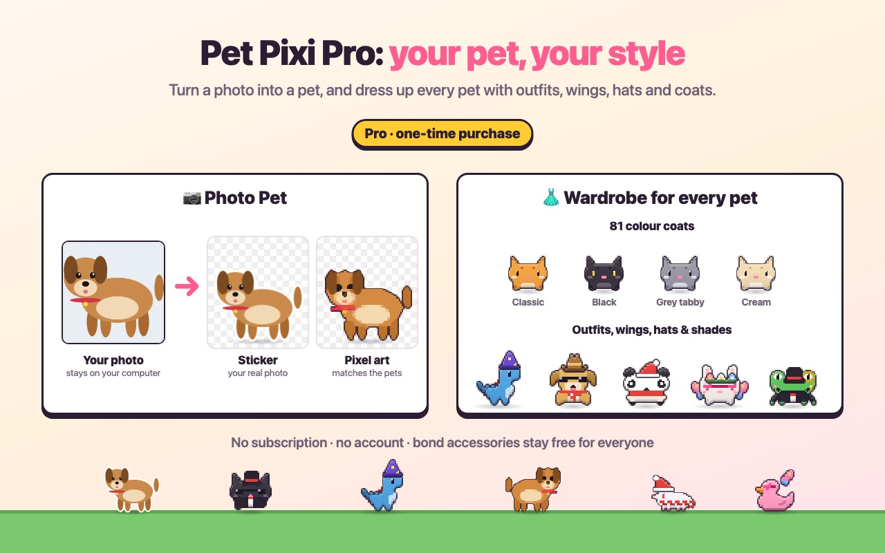
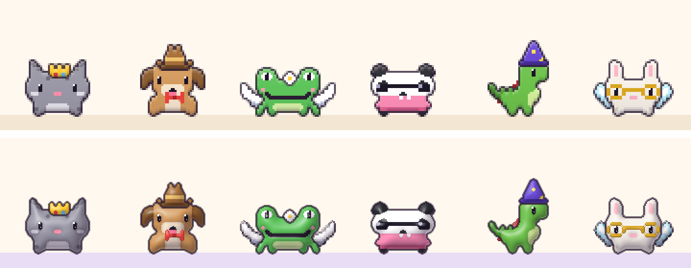

  

<h1 align="center">Pet Pixi — Pixel Pets for Your Chrome Tabs</h1>

  <b>Tiny pixel pets that live in your tabs — even your own pet.</b> 
  Adopt one of 27 cute pixel pets, or turn a photo of your real dog, cat or bunny into a pixel pet that walks along the bottom of every website. 
  Feed it, pet it, play ball, watch it nap in a nightcap — and grow your bond a little every day.

   
  ⭐ Available now on the <a href="https://chromewebstore.google.com/detail/fgafahmolfgajejjdmeoimapeojnfipf?utm_source=github&utm_medium=readme"><b>Chrome Web Store</b></a> · works in Chrome, Edge, Brave and Opera

  
  
  
  
  
  

  <a href="https://chromewebstore.google.com/detail/fgafahmolfgajejjdmeoimapeojnfipf?utm_source=github&utm_medium=readme"><b>🧩 Add to Chrome</b></a> ·
  <a href="https://github.com/ThevinMalaka/pet-pixi-chrome-extension"><b>🌐 GitHub</b></a> ·
  <a href="#-whats-new-in-104">What's new</a> ·
  <a href="#-how-to-videos">Videos</a> ·
  <a href="#-install">Install</a> ·
  <a href="#-features">Features</a> ·
  <a href="#-wardrobe">Wardrobe</a> ·
  <a href="#-bond-levels--daily-care">Bond levels</a> ·
  <a href="#-pet-pixi-pro--photo-pet-wardrobe--ultra-hd"><b>⭐ Pro</b></a> ·
  <a href="#-privacy">Privacy</a> ·
  <a href="#-faq">FAQ</a>

---

## 🐶 What is Pet Pixi?

Pet Pixi is a free **virtual pet Chrome extension**. It puts a tiny **pixel pet** at the bottom of every browser tab — a little desktop companion that walks, naps, chases balls and waits for snacks while you work, study or browse.

- **Pick a pixel pet** — 27 hand-drawn friends: cat, dog, bunny, fox, panda, frog, dino, turtle, snail and more.
- **Or bring your own pet** — upload a photo of your real dog, cat, bunny or bird and Pet Pixi turns it into a **pixel art pet** (or a cute cut-out sticker) that lives in your tabs. Your photo is processed on your computer and never uploaded. *(Photo Pet is part of [Pet Pixi Pro](#-pet-pixi-pro--photo-pet-wardrobe--ultra-hd), a one-time purchase.)*
- **See them in soft 3D** — with **Ultra HD** every pet becomes a little glossy 3D toy, outfits included. *(Pro)*
- **Cozy, never needy** — pets never die, run away or get sick. No account, no sign-in, no ads.
- **Works everywhere you browse** — Google Chrome, Microsoft Edge, Brave and Opera.

  <a href="https://chromewebstore.google.com/detail/fgafahmolfgajejjdmeoimapeojnfipf?utm_source=github&utm_medium=readme"><b>🧩 Add Pet Pixi to Chrome — free</b></a>

---

## 🆕 What's new in 1.0.4

- ✨ **Ultra HD** *(Pro)* — a new pixel style that turns every pet into a soft **3D toy**: rounded bodies lit from above, glossy highlights, soft shadows and shiny eyes, drawn at 4× the detail. Hats, glasses, collars, wings, capes and outfits get the same 3D look.
- ⚽ **Play ball as much as you like** — no more waiting between games. Bond XP still comes from 3 games a day, so levels grow at the same steady pace.
- 🎨 **30 toy balls** — beach balls, tennis balls, stars, stripes, polka dots, two-tone, hoops and more, in lots of colours. Every throw is a different ball.
- 🚀 **Bigger throws** — pets throw the ball right across the screen and race after it.
- 🗂️ **Balls and food follow you between tabs** — switch tabs in the same window and your pet is still chasing its ball or finishing its snack.
- 💬 **Clear messages** — a readable note above your pet says when it's full, when the next XP game is ready and more.
- ⚡ **The popup opens instantly**, even with lots of Ultra HD pets.

---

## 🎬 How-to videos

<table>
  <tr>
    <td width="50%" align="center">
       
      <b>How to install Pet Pixi</b> 
      Chrome Web Store → Add to Chrome → adopt your first pet → pin it
    </td>
    <td width="50%" align="center">
       
      <b>How to get Pet Pixi Pro</b> 
      Unlock Pro → pay by card → copy your key → paste &amp; activate
    </td>
  </tr>
</table>

---

## 🐾 Meet the pets

27 hand-made pixel friends. Pick one (or up to **five** — ten with Pro) and they follow you from tab to tab.

  

Every pet has its own favourite food 🍖 — feed them that and they're extra happy.

| Pet | Loves | Pet | Loves | Pet | Loves |
|---|---|---|---|---|---|
| Bunny | carrot | Fox | bone | Rat | cheese |
| Cat | fish | Frog | bug | Rocky | cookie |
| Chicken | seeds | Horse | carrot | Rubber Duck | bread |
| Clippo | cookie | Mod | bolt | Skeleton | bone |
| Cockatiel | seeds | Monkey | banana | Snail | leaf |
| Crab | fish | Morph | apple | Snake | apple |
| Dog | bone | Panda | bamboo | Squirrel | acorn |
| Dino | leaf | Raccoon | cookie | Mossling | acorn |
| Finley | bug | Turtle | leaf | Zappy | bolt |

---

## ✨ Features

### 🏡 Lives in your tabs
- Your pets walk, idle, blink, nap and explore along the **bottom of every website** you open.
- **Synced across all your tabs** — same pets, same stats, and your pet is right where you left it when you switch tabs.
- **Hover** a pet for its little toolbar: 🍖 Feed · ⚽ Play · ❤️ Pet · 🌙 Nap · ✕ Hide.
- **Click** to pet it, or **stroke** it by moving your mouse back and forth over it.
- **Drag & drop** your pet anywhere — it tumbles back down with a bounce.

### ⚽ Play ball
- **Play as much as you like** — hit ⚽ and your pet runs after the ball, every time.
- **30 toy balls** — classic, beach, stripes, polka dots, stars, tennis, hoops, two-tone and patches, in lots of colours. Each throw picks a different one, so with several pets you can tell whose ball is whose.
- **Big throws** — a pet on the left throws to the right (and back again), right across the screen.
- 🎲 **Surprise toss** — tap **Toss** at the top of the Pet Pixi popup and a ball drops from the top of the page at a random spot. A random pet spots it and races to catch it. It's just for fun: no XP and no limits, so toss as often as you like.
- Balls and snacks **wait for their pet**, and keep going when you switch to another tab in the same window.

### 🤝 Friends & meetups
When two pets bump into each other, they play out a little scene:

  

| Scene | What happens |
|---|---|
| 💬 **Chat** | They take turns "talking" in speech bubbles — ♪ ? … ✦ ❤️ — hopping as they speak, then wave goodbye. |
| 🦘 **Leapfrog** | One crouches, the other jumps right over it to the far side ✦ |
| 🏃 **Tag** | "!" — one runs off, the other chases, then a happy hop. |
| 💃 **Dance** | Alternating hops, little spins and music notes. |
| 😴 **Snuggle** *(night)* | They curl up side by side for a nap. |

Pets also wander over to visit each other on their own, and meetups make both of them happier.

### 🌙 Day & night

  

After **8 pm** pets slow down, glow softly and walk to the **bottom-right corner**, where they fall asleep side by side in little **nightcaps** while fireflies come out. In the morning they wake up with a stretch and a ☀️. (Settings: *Follow clock · Always · Never*.)

### 🧭 Free roam *(optional)*
Turn it on and pets explore **every edge of the window** — up the walls and upside down along the top. Food and balls still land on the floor, so pets walk all the way round to reach them.

### 👗 Wardrobe

  

Dress your pets in the **Wardrobe** tab: pick a pet, then tap through **Hats · Face · Neck · Outfits · Back · Coats**. Every tile shows *your* pet wearing the item, and the big preview turns around and tries on any look. Feeling lucky? Hit **🎲 Surprise me**.

- **Free bond rewards** — one new item at every bond level: 🎀 bow · 🔔 collar & bell · 🌸 flower · 🧣 bandana · 🥳 party hat · 😊 blush · 👑 crown · 🧶 scarf · ⭐ star.
- **With Pro** — 81 colour coats, outfits (hoodie, striped sweater, raincoat, denim jacket, tuxedo, bumblebee, ghost), wings (angel, bat, butterfly, fairy), a hero cape and a balloon, bow ties, pearls, flower leis and gold chains, 17 hats from wizard to pirate, and shades, monocles and eye patches.
- Everything fits all 27 pets, and your pets wear their look on every website.
- In **Ultra HD** *(Pro)* every item gets the same smooth edges and 3D lighting as your pet.

### 🎨 Make it yours
- **Pet size** from tiny to big.
- **Pixel style:** *HD pixels* (smooth, shaded, sparkly eyes), *Retro* (chunky classic pixels), or *Ultra HD* with Pro (soft 3D pets with real light, shade and glossy highlights, at 4× the detail).
- **Popup theme:** follows your computer's light or dark mode, or pick one.
- **Name** every pet and see how many days you've been together.

### 🙈 Hide anytime
Three easy ways, each with **this tab / this site / all tabs**:
1. **Right-click** any page (or the toolbar icon) → *Hide pets on this tab / site / all tabs*.
2. The pet's **✕** button.
3. The **popup** — one click to hide or show again.

Pets also hide automatically in **fullscreen** video.

---

## ❤️ Bond levels & daily care

Bond shows how close you and a pet are. It grows from **caring a little every day** — not from clicking fast — and it **never goes down**. Pets never die, run away or get sick. 🫶

| Activity | XP | Daily limit |
|---|---|---|
| 🍖 Feed when hungry | +3 (+5 with favourite food) | 3 meals, 45 min apart — full pets politely refuse |
| ⚽ Play ball | +4 | Play as much as you like — 3 games a day give XP, 3 min apart |
| ❤️ Pet / stroke | +1 | 10 cuddles |
| ✅ **Daily care goal** — 1 meal + 1 game + 5 cuddles | **+5 bonus** | once a day |
| 📅 Daily visit | +5, plus +2 per day in a row (up to +10) | once a day |

Each pet can earn up to **30 XP a day** from feeding, playing and cuddles. The popup shows today's progress on every pet.

| Lv | Title | XP | Unlocks |
|---|---|---|---|
| 1 | New friend | 0 | — |
| 2 | Buddy | 15 | 🎀 Bow |
| 3 | Pal | 45 | 🔔 Collar & bell |
| 4 | Close friend | 90 | 🌸 Flower |
| 5 | Best friend | 150 | 🧣 Bandana |
| 6 | Partner | 230 | 🥳 Party hat |
| 7 | Soulmate | 330 | 😊 Blush |
| 8 | Family | 450 | 👑 Crown |
| 9 | Inseparable | 600 | 🧶 Scarf |
| 10 | **Legendary bond** | 800 | ⭐ Star |

Bond rewards are always free. Unlocked items appear in the **Wardrobe** tab — locked ones can still be tried on in the preview.

---

## ⭐ Pet Pixi Pro — Photo Pet, Wardrobe & Ultra HD

  <b>Your pet, your style.</b> Bring your <i>real</i> pet into your browser, dress up every pet you love, and see them all in soft 3D.

  

  
  
  
  

<table>
  <tr>
    <td width="50%" valign="top">
      <h3>📷 Photo Pet</h3>
      <b>Your real pet, living in your tabs.</b> 
      Upload a photo of your dog, cat, bunny or bird and keep it as a cute cut-out <b>sticker</b> or turn it into <b>pixel art</b> that matches the other pets. Tell Pet Pixi what kind of pet it is and it trots, hops, flies or slithers to match.
    </td>
    <td width="50%" valign="top">
      <h3>👗 The full Wardrobe</h3>
      <b>A new look for every mood.</b> 
      81 colour coats (black cat, golden retriever, blue dino…), hoodies, tuxedos and a bumblebee costume, angel, bat and fairy wings, a hero cape, bow ties and pearls, 17 hats from wizard to pirate, and cool shades.
    </td>
  </tr>
  <tr>
    <td width="50%" valign="top">
      <h3>🎀 Dress it just right</h3>
      <b>Your photo, your styling.</b> 
      Drag bows, hats, flowers and the bedtime nightcap to the perfect spot on your Photo Pet, then resize and tilt them until it looks just like your pet.
    </td>
    <td width="50%" valign="top">
      <h3>🐾 A bigger family</h3>
      <b>Room for everyone.</b> 
      Keep up to <b>10 pets</b> at once instead of 5, and watch them all make friends, play tag and snuggle up together at night.
    </td>
  </tr>
  <tr>
    <td colspan="2" valign="top">
      <h3>✨ Ultra HD</h3>
      <b>Your pets, in soft 3D.</b> 
      Switch on Ultra HD in Settings and every pet becomes a little 3D toy: rounded bodies lit from above, glossy highlights, soft shadows and shiny eyes, drawn at four times the detail. Hats, glasses, wings and outfits get the 3D look too.
    </td>
  </tr>
</table>

   
  Top: HD · Bottom: <b>Ultra HD</b> ✨

### Free vs Pro

Pet Pixi is free and complete on its own. Pro adds your own pet, a lot more style and Ultra HD.

| | Free | Pro ★ |
|---|:---:|:---:|
| 27 hand-drawn pixel pets | ✅ | ✅ |
| Feed, pet, drag & drop — and unlimited ball play with 30 toy balls | ✅ | ✅ |
| Bond levels 1–10 + 9 free bond rewards | ✅ | ✅ |
| Friends & meetups, day & night, free roam | ✅ | ✅ |
| Pets at once | 5 | **10** |
| 📷 **Photo Pet** — your own pet in your tabs | — | ✅ |
| 🎨 **81 colour coats** | — | ✅ |
| 👕 **Outfits, wings, capes, 17 hats, shades** | — | ✅ |
| 🎀 **Place, resize & tilt accessories on your photo** | — | ✅ |
| ✨ **Ultra HD** — soft 3D pets (and outfits) with real light & gloss | — | ✅ |

<b>📸 Tips for the best Photo Pet</b>

- **Best result:** a **PNG with a transparent background** (cut your pet out first with your phone's "lift subject" / "remove background" tool). Ordinary photos work too — plain backgrounds are removed automatically.
- 🔒 **Your photo never leaves your computer.** Everything is processed inside the extension; only the small finished pet is kept.
- 🐕 **Kinds of pet:** dog, cat, bunny, bird, flying, duck, hamster, turtle or snake/fish. You can change it later from the pet card.

### 💛 Get Pro in a minute

Payments are handled by [Dodo Payments](https://dodopayments.com), who take care of checkout, receipts, taxes and refunds.

1. [Install Pet Pixi](https://chromewebstore.google.com/detail/fgafahmolfgajejjdmeoimapeojnfipf?utm_source=github&utm_medium=readme) (free), open the popup → **Pro ★** → **Unlock Pro** (the current price is shown there). Or tap any ★ Pro item in the Wardrobe, or **Ultra HD ★** in Settings.
2. Pay on the secure Dodo Payments checkout. Your **license key** arrives by email.
3. Paste the key into the popup (**Pro ★** → *Already bought Pro? Enter your key*) → **Activate**. Done — no sign-up, no password.
4. Turn on 3D pets: **Settings → Pixel style → Ultra HD ★**.

▶ **[Watch how it works (1 min)](assets/howto-pro.mp4)**

Pet Pixi is made by one indie developer — every Pro unlock helps keep it ad-free and growing with new pets and outfits. Thank you! 💖

Pet Pixi checks your key with Dodo Payments once a day. If you're offline, Pro keeps working (for up to 30 days without a check). Every pet you adopted stays yours, Pro or not.

---

## 🔒 Privacy

Pet Pixi is private by design.

- **No accounts, no ads, no tracking of what you browse.** Pet Pixi never reads page content, web addresses or anything you type.
- Your pets and settings live **only on your computer** — uninstalling removes them.
- Photo Pet photos are processed **on your computer** and never uploaded.
- **Optional anonymous usage stats** (switch off any time in *Settings*): once a day a random install id, version, browser language, pet types and whether Pro is on. Your **IP address is never stored**.

Full privacy policy: **[PRIVACY.md](PRIVACY.md)**

<b>Permissions and why they're needed</b>

| Permission | Why |
|---|---|
| Read and change data on websites | Draw your pets on the pages you visit. Pet Pixi doesn't read page content. |
| Storage | Save your pets and settings on your computer. |
| Alarms | Show the "someone is hungry" badge and send the optional daily stats ping. |
| Scripting | Add pets to tabs that were already open when you installed. |
| Context menus | The right-click *Hide pets…* options. |
| `live.dodopayments.com` | Activate your Pro license key. |

---

## 📦 Install

   
  Free · no account · no ads

1. Open **[Pet Pixi on the Chrome Web Store](https://chromewebstore.google.com/detail/fgafahmolfgajejjdmeoimapeojnfipf?utm_source=github&utm_medium=readme)** and click **Add to Chrome**.
2. The welcome page opens — pick your first pet and give it a name.
3. Open any website and look down. Your new friend is already exploring. 🎉

Tip: pin Pet Pixi from the 🧩 puzzle-piece menu so your pets are one click away.
▶ **[Watch the 1-minute install video](assets/howto-install.mp4)**
Works in Chrome and other Chromium browsers (Edge, Brave, Opera).

---

## 🗺 Roadmap

- [x] A wardrobe with outfits, wings, hats and coats
- [x] Ultra HD: soft 3D pets
- [x] Unlimited ball play with 30 toy balls
- [ ] Seasonal events (snowy days, spooky nights)
- [ ] A little pet diary
- [ ] Export / import your pets
- [ ] Optional cute sounds (off by default)
- [ ] Call your pet to the cursor with a shortcut
- [ ] More poses for Photo Pets

Ideas welcome — open an issue! 💡

---

## ❓ FAQ

<b>How do I get a pixel pet in my Chrome browser?</b>

Install <a href="https://chromewebstore.google.com/detail/fgafahmolfgajejjdmeoimapeojnfipf?utm_source=github&utm_medium=readme">Pet Pixi from the Chrome Web Store</a>, pick a pet on the welcome page and give it a name. Open any website and your pet is walking along the bottom of the tab.

<b>Can I turn a photo of my own pet into a pixel pet?</b>

Yes — that's Photo Pet, part of Pet Pixi Pro (one-time purchase). Upload a photo of your dog, cat, bunny, bird or any pet, keep it as a cut-out sticker or turn it into pixel art, and it lives in your browser tabs like the other pets. The photo is processed on your computer and never uploaded.

<b>Why don't pets appear on the New Tab page?</b>

Chrome doesn't allow any extension to draw on the New Tab page, `chrome://` pages or the Chrome Web Store. Open any regular website and your pets are there.

<b>Can my pet die or run away if I forget it?</b>

Never. Hungry or lonely pets just look a bit sad and show a small bubble. Bond levels never go down.

<b>Will my pets sync to my other computer?</b>

No — on purpose. Pets live only in this Chrome profile, with no account. Another Chrome (or profile) starts fresh, so you can adopt different friends there.

<b>Why didn't I get XP when I clicked Feed again?</b>

Bond grows from daily care, not fast clicking: full pets refuse food, meals give XP up to 3 times a day, and 3 games of ball a day give XP (3 min apart). You can still play ball as much as you like — extra games just don't add XP. The popup and a note above your pet tell you exactly why and when. Want to play without thinking about XP? The **Toss** ball at the top of the popup is always just for fun.

<b>What is Ultra HD?</b>

A Pet Pixi Pro pixel style (Settings → Pixel style → **Ultra HD ★**). Every pet is drawn at four times the detail and lit like a little 3D toy — rounded body, light from above, glossy highlights, soft shadows and shiny eyes — and hats, glasses, wings and outfits match. You can switch back to HD or Retro any time. Without Pro you can preview it in Settings.

<b>Is Pro a subscription? Can I get a refund?</b>

Pro is a **one-time** purchase — no subscription. Payments, receipts and refunds are handled by Dodo Payments — reply to your receipt email or visit <a href="https://github.com/ThevinMalaka/pet-pixi-chrome-extension">github.com/ThevinMalaka/pet-pixi-chrome-extension</a>.

<b>Is my photo uploaded anywhere?</b>

No. Photo Pet processing happens entirely inside the extension on your computer.

<b>How do I hide pets on a website I'm working on?</b>

Right-click the page → *Hide pets on this site*, or use the pet's ✕ button. Bring them back the same way or from the popup.

---

## 💌 Support

Enjoying Pet Pixi? A quick ⭐ review on the **[Chrome Web Store](https://chromewebstore.google.com/detail/fgafahmolfgajejjdmeoimapeojnfipf?utm_source=github&utm_medium=readme)** helps other people find their new pixel friend.

Questions, bugs or pet ideas: **[github.com/ThevinMalaka/pet-pixi-chrome-extension](https://github.com/ThevinMalaka/pet-pixi-chrome-extension)** (open an issue) or email **[thevinmalaka@gmail.com](mailto:thevinmalaka@gmail.com)**.

## 📄 License

© 2026 Pet Pixi. All rights reserved. The Pet Pixi name, pixel art and software may not be copied, modified, redistributed or sold without written permission.

  <a href="https://chromewebstore.google.com/detail/fgafahmolfgajejjdmeoimapeojnfipf?utm_source=github&utm_medium=readme">🧩 Add to Chrome</a> · <a href="https://github.com/ThevinMalaka/pet-pixi-chrome-extension">🌐 github.com/ThevinMalaka/pet-pixi-chrome-extension</a> · <a href="mailto:thevinmalaka@gmail.com">✉️ thevinmalaka@gmail.com</a> · Made with 💖 and lots of tiny pixels.

